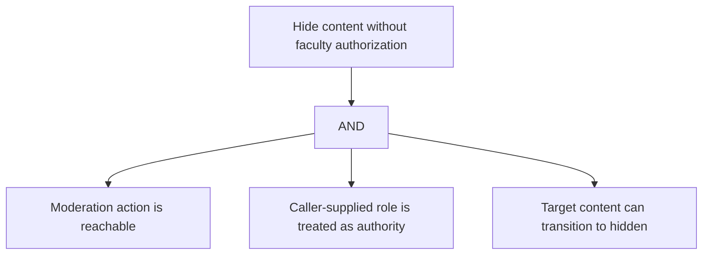
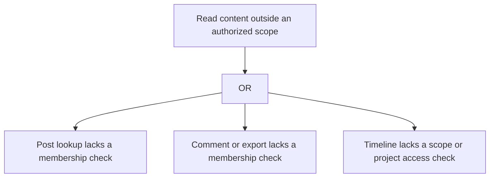
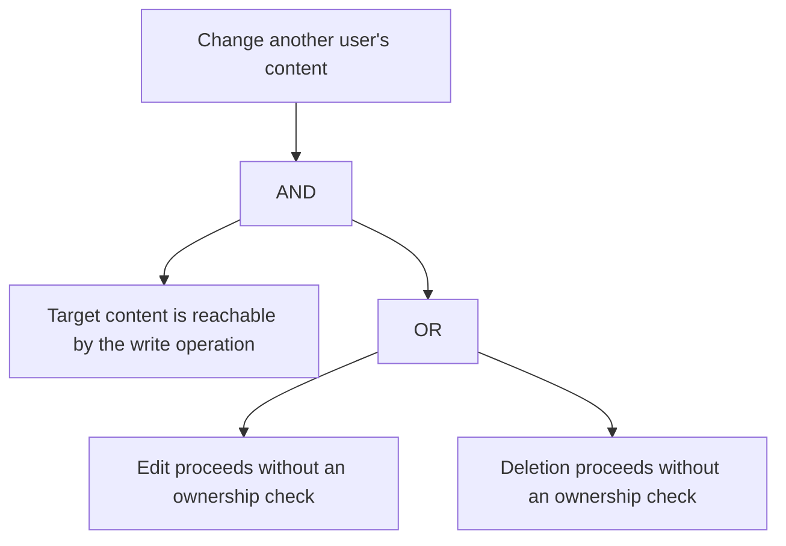
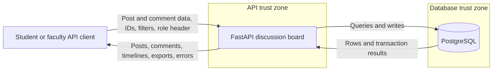

# PA2 Security Analysis

## AI Deliverable Metadata

- **AI tool:** ChatGPT
- **Estimated conceptual AI contribution:** 75%
- **AI assistance:** I asked ChatGPT to compare the assignment rubric with my PA2 code and help draft the data flow diagram, attack surface map, STRIDE analysis, abuse cases, and mitigations.
- **Analysis scope:** Domain 4 Research Blog & Project Discussion Board, PA2 baseline on `assignment-2`, commit `6a29856`.
- **Evidence:** This analysis uses source review of the FastAPI routes, database models, request schemas, and integration tests. The risks below are based on the baseline design.

## 1. Security Requirements

| ID   | Requirement                                                                                                                                                                           |
| ---- | ------------------------------------------------------------------------------------------------------------------------------------------------------------------------------------- |
| SR-1 | The API should verify the caller's identity and derive the author and role from that identity.                                                                                        |
| SR-2 | The API should check scope membership before returning posts, comments, timelines, or exports. Course and lab timelines should apply access checks to the project posts they include. |
| SR-3 | The API should allow edits and deletions only when the caller has permission for the specific post or comment.                                                                        |
| SR-4 | Only authorized faculty should be able to hide or restore content within scopes they moderate. The API should enforce allowed moderation state transitions.                           |
| SR-5 | The service should keep an audit record of sensitive actions, including who acted, what changed, and when it happened.                                                                |
| SR-6 | The API should limit request sizes and repeated requests. List and export operations should limit how much data they return at once.                                                  |
| SR-7 | The database should accept connections only from approved services and administrators. The application should use a database role limited to its runtime needs.                       |
| SR-8 | Any frontend that displays stored rich text should sanitize it before rendering it as HTML.                                                                                           |

## 2. Abuse Cases

| ID   | Abuse case                                                                                                                                                                                                            | Impact                                                                                                                                        | Security requirements |
| ---- | --------------------------------------------------------------------------------------------------------------------------------------------------------------------------------------------------------------------- | --------------------------------------------------------------------------------------------------------------------------------------------- | --------------------- |
| AC-1 | A caller without faculty permission hides a post or comment. The baseline moderation check relies on a role supplied by the client.                                                                                   | Legitimate content disappears from normal views. Hiding a parent comment can also hide its replies.                                           | SR-1, SR-4, SR-5      |
| AC-2 | A caller reads posts, comments, or exports from a scope they are not authorized to access.                                                                                                                            | Private project discussions or research updates could be disclosed. Course and lab timelines can also include posts from associated projects. | SR-2                  |
| AC-3 | A caller changes or deletes a post without permission. My local checks for MF-1 showed that the app accepted an update and a separate deletion without credentials. The update also changed the stored author handle. | The discussion record can be altered or removed, and a post can be attributed to someone else.                                                | SR-1, SR-3            |
| AC-4 | A caller repeatedly requests large comment exports. The source review for MF-2 showed that the app builds the full visible thread in memory without an export-size limit.                                             | Large exports could consume memory and processing time. I did not measure the runtime impact.                                                 | SR-6                  |

## 3. Attack Trees

The trees show the security conditions that would allow each abuse case. At an **AND** node, all listed conditions must hold. At an **OR** node, any one branch is sufficient.

### AC-1 — Hide content without faculty authorization

### AC-2 — Read content outside an authorized scope

### AC-3 — Change another user's content

## 4. Attack Surface Mapping

In the tables below, the API routes are relative to `/api/v1/discussions`. I marked direct access to other users' content, content changes, and privileged moderation as high risk because they affect confidentiality or integrity.

| Method and path                                         | Inputs or behavior                                                                 | Risk                                                                                                          |
| ------------------------------------------------------- | ---------------------------------------------------------------------------------- | ------------------------------------------------------------------------------------------------------------- |
| `POST /posts`                                           | Post body, author handle, category, scope, and tags.                               | **High.** Author attribution and scope assignment depend on client-supplied data.                             |
| `GET /posts`                                            | Search, time, author, category, and scope filters.                                 | **High.** Listing can disclose content beyond the caller's scope.                                             |
| `GET /posts/{post_id}`                                  | Retrieves a visible post by UUID.                                                  | **High.** Visibility and scope membership need separate checks.                                               |
| `PUT`, `DELETE /posts/{post_id}`                        | Edits or deletes a post by UUID.                                                   | **High.** These operations need authorization for the specific post.                                          |
| `POST /posts/{post_id}/comments`                        | Comment body, author handle, and optional parent comment ID.                       | **High.** The API needs to check the caller's right to participate in that thread.                            |
| `GET /posts/{post_id}/comments`                         | Lists comments or returns a plain-text thread export.                              | **High.** Both response formats need the same access checks. Full exports can disclose more data per request. |
| `GET /posts/{post_id}/comments/{comment_id}`            | Retrieves an individual comment by UUID.                                           | **High.** The API needs to authorize access to the parent post and comment.                                   |
| `PUT`, `DELETE /posts/{post_id}/comments/{comment_id}`  | Edits or deletes a comment. Deletion is subject to reply constraints.              | **High.** The reply constraint protects thread structure. Ownership still needs its own check.                |
| `POST /posts/{post_id}/report`                          | Changes an active post to reported.                                                | **Medium.** Reports need an authenticated actor and rate controls.                                            |
| `POST /posts/{post_id}/comments/{comment_id}/report`    | Changes an active comment to reported.                                             | **Medium.** Reports need an authenticated actor and rate controls.                                            |
| `PUT /moderation/posts/{post_id}`                       | Changes a post's moderation state. The baseline reads a mock faculty role header.  | **High.** The role must come from a trusted identity.                                                         |
| `PUT /moderation/posts/{post_id}/comments/{comment_id}` | Changes a comment's moderation state. The baseline reads the same role header.     | **High.** Hiding a parent comment can also affect the visibility of replies.                                  |
| `GET /scopes/{scope_type}/{scope_id}/timeline`          | Returns a scope timeline, including associated project posts for courses and labs. | **High.** Authorization must cover the requested scope and the content included through associations.         |

| Additional entry point             | Exposure and risk                                                                                                                                   |
| ---------------------------------- | --------------------------------------------------------------------------------------------------------------------------------------------------- |
| `/docs`, `/redoc`, `/openapi.json` | FastAPI documentation and schema routes. Review whether these should be exposed outside development.                                                |
| PostgreSQL development listener    | Docker Compose publishes it on host loopback. Local processes with database access can bypass API checks. Keep its exposure and privileges limited. |

## 5. Data Flow Diagram

The client is outside the API trust boundary. PostgreSQL is in a separate trust zone because access to it allows direct reads and writes of stored application data.

PostgreSQL stores posts, comments, moderation states, and project associations with courses and labs. The FastAPI service uses those associations to assemble timeline responses. The mock faculty role crosses the client-to-API boundary as request data.

## 6. STRIDE Matrix

| DFD element               | Spoofing                                                               | Tampering                                                                    | Repudiation                                                                                                    | Information disclosure                                                                                                     | Denial of service                                                         | Elevation of privilege                                                                           |
| ------------------------- | ---------------------------------------------------------------------- | ---------------------------------------------------------------------------- | -------------------------------------------------------------------------------------------------------------- | -------------------------------------------------------------------------------------------------------------------------- | ------------------------------------------------------------------------- | ------------------------------------------------------------------------------------------------ |
| **Client**                | A caller can claim another author's handle or a faculty role.          | A caller controls submitted content, IDs, filters, and headers.              | A caller can deny making an action if it was never linked to a verified identity.                              | A caller may request data from another scope.                                                                              | A caller can repeatedly request lists, reports, or exports.               | A caller may be treated as faculty based on an unverified role.                                  |
| **Client ↔ API flow**     | A request can carry an unverified identity or authority claim.         | Request fields may direct the service to a different object or scope.        | Requests lack reliable attribution without verified actor IDs and audit records.                               | Responses may carry private content across the boundary.                                                                   | Large or repeated requests increase processing and response costs.        | The moderation header crosses into a privileged decision.                                        |
| **FastAPI service**       | Author and moderator claims need to be tied to verified identity.      | Write routes need object-level checks before changing stored records.        | Sensitive changes need an audit trail that records the actor and outcome.                                      | Reads and exports need consistent scope authorization. Stored rich text also requires safe handling by a rendering client. | Unbounded results and repeated queries can consume resources.             | Moderation needs a verified faculty role and a scope check.                                      |
| **API ↔ PostgreSQL flow** | Database connections depend on the configured database identity.       | A connection with write privileges can alter posts, states, or associations. | Application actions can share one database identity, so actor attribution must be recorded by the application. | Queries and returned rows contain private content. Protect the connection if it crosses a network.                         | Expensive queries or too many connections can exhaust database resources. | An overly privileged application account can exceed the access needed for normal API operations. |
| **PostgreSQL**            | Someone with valid database credentials can act as that database role. | Direct writes can change or delete records and associations.                 | Database history alone may not identify the API user responsible for a change.                                 | Direct reads can expose posts, comments, and associations.                                                                 | Unrestricted storage growth or expensive queries can affect availability. | A broad database role can modify more data or schema objects than the application needs.         |

The first three abuse cases reflect gaps visible in the baseline API design. The database and transport risks describe conditions to account for if the service moves beyond local development.

## 7. Proposed Mitigations

| Priority | Threat or requirement                                      | Proposed mitigation                                                                                                                                                                                                                                        |
| -------- | ---------------------------------------------------------- | ---------------------------------------------------------------------------------------------------------------------------------------------------------------------------------------------------------------------------------------------------------- |
| High     | Identity and role spoofing (SR-1, SR-4, AC-1)              | Authenticate callers and derive their identity and role from trusted server-side data. Before allowing moderation, verify that the caller is faculty and has permission to moderate the target scope.                                                      |
| High     | Cross-scope reads and exports (SR-2, AC-2)                 | Check scope membership before returning posts, comments, or exports. Apply the same access rules to JSON and text responses and to posts included in course or lab timelines through project associations.                                                 |
| High     | Unauthorized edits and deletions (SR-1, SR-3, AC-3, MF-1)  | Verify the caller's identity and check permission for the specific post or comment before changing it. Verify that a comment belongs to the expected post and preserve the stored author during ordinary edits.                                            |
| High     | Invalid moderation state changes (SR-4)                    | Enforce allowed state transitions on the server. Save each accepted moderation change and its audit event in the same database transaction.                                                                                                                |
| High     | Missing attribution for sensitive changes (SR-5)           | Record the verified actor, action, target, timestamp, and outcome for post and comment edits, deletions, and moderation. For moderation, also record the previous and new states.                                                                          |
| Medium   | Reporting abuse and resource exhaustion (SR-6, AC-4, MF-2) | Limit request size and frequency, paginate list responses, and cap thread export size. Process comments in bounded batches if full-thread exports are needed. Track reports by verified user to handle repeated submissions.                               |
| Medium   | Database exposure and excessive privileges (SR-7, MF-3)    | Require explicit database credentials outside local development. Restrict database network access, give the API a least-privilege account, and use a separate account for schema changes. Protect database connections with TLS when they cross a network. |
| Medium   | Unsafe HTML rendering (SR-8)                               | If a frontend renders stored rich text as HTML, sanitize it against an allowlist before display. Escape ordinary text when rendering it.                                                                                                                   |
| Medium   | Client-to-API traffic exposure                             | Require HTTPS outside local development to protect requests and responses in transit.                                                                                                                                                                      |

I would implement verified identity, scope authorization, and ownership checks first. These controls determine who can read private discussions, change stored content, and perform moderation.
